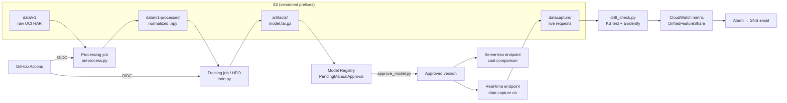

# sagemaker-har-pipeline


An end-to-end MLOps pipeline on AWS SageMaker for human activity recognition
(HAR) from wearable inertial sensors: versioned data, processing, training,
hyperparameter tuning, a model registry with an approval gate, real-time and
serverless serving, drift monitoring with alerting, and CI/CD through GitHub
Actions with keyless (OIDC) AWS access.

The model is deliberately small (a 1D CNN). **The pipeline is the
deliverable.** Each stage is measured, and the trade-offs behind each
choice are written down in [`docs/`](docs/).

## Results at a glance

| Area | Result | Details |
|---|---|---|
| Model | **0.9355** test accuracy after Bayesian HPO (baseline 0.9094) | [`docs/hpo.md`](docs/hpo.md) |
| Latency | **~16 ms** server-side p50 (model 9.0 + platform 6.7). ~93% of the 243 ms client latency is network and JSON transfer | [`docs/serving.md`](docs/serving.md) |
| Cost | Serverless ≈ $0.00000078/request. A real-time `ml.m5.large` ($84/month) only wins above **~3.5M requests/day** | [`docs/serving.md`](docs/serving.md) |
| Cold start | Serverless first call **4.1 s** vs ~260 ms warm | [`docs/serving.md`](docs/serving.md) |
| Drift detection | Healthy traffic: 0/18 features flagged. Simulated miscalibrated sensor: 18/18. Weakest drift signal (KS 0.193) is above the strongest healthy one (KS 0.129) | [`docs/monitoring.md`](docs/monitoring.md) |
| Security | CI/CD uses short-lived OIDC credentials pinned to immutable repo IDs. No stored AWS keys | [`docs/design-decisions.md`](docs/design-decisions.md) |

## Architecture



## Pipeline walkthrough

| Stage | Script | What it does |
|---|---|---|
| Processing | [`launch_processing.py`](src/launch_processing.py) → [`preprocess.py`](src/preprocess.py) | Stacks the 9 raw sensor channels into (N, 9, 128) windows and applies per-channel z-score normalization. Statistics come from the training split only, to avoid leakage |
| Training | [`launch_training.py`](src/launch_training.py) → [`train.py`](src/train.py) | Trains a 1D CNN ([`model.py`](src/model.py)). Metrics are printed in a fixed format that SageMaker scrapes into CloudWatch |
| Tuning | [`launch_hpo.py`](src/launch_hpo.py) | Bayesian search over learning rate and batch size, 8 trials |
| Registry | [`register_model.py`](src/register_model.py), [`approve_model.py`](src/approve_model.py) | Registers the best model with lineage metadata. Approval is a separate, explicit step |
| Serving | [`deploy_endpoint.py`](src/deploy_endpoint.py), [`deploy_serverless.py`](src/deploy_serverless.py), [`inference.py`](src/inference.py) | Deploys only the latest **Approved** version. Real-time endpoint with data capture, plus a serverless variant for comparison |
| Testing the endpoint | [`smoke_test.py`](src/smoke_test.py), [`latency_test.py`](src/latency_test.py), [`send_traffic.py`](src/send_traffic.py) | Correctness checks, p50/p95/p99 latency, and normal vs. deliberately drifted traffic |
| Monitoring | [`drift_check.py`](src/drift_check.py), [`monitor_preprocessor.py`](src/monitor_preprocessor.py), [`setup_monitoring.py`](src/setup_monitoring.py) | Per-feature drift tests on captured traffic, a CloudWatch metric, alarms, and a dashboard |
| CI/CD | [`.github/workflows/`](.github/workflows/), [`infra/`](infra/) | Lint and unit tests on every push. A one-click pipeline run on AWS that passes the tests first |

## Running it

Prerequisites: an AWS account with a SageMaker execution role, the AWS CLI
configured for `us-west-2`, Python 3.12, and the UCI HAR dataset
([download](https://archive.ics.uci.edu/dataset/240/human+activity+recognition+using+smartphones))
unzipped into `data/` and uploaded to the S3 layout below.

```bash
pip install torch numpy scipy pandas boto3 "sagemaker<3" "evidently>=0.7"

python src/launch_processing.py        # raw -> v1-processed
python src/launch_training.py          # train
python src/launch_hpo.py               # optional: tune
python src/register_model.py           # register best model (pending approval)
python src/approve_model.py            # promote to Approved
python src/deploy_endpoint.py          # deploy latest Approved version
python src/smoke_test.py               # check predictions

aws sagemaker delete-endpoint --endpoint-name har-classifier   # endpoints bill hourly
```

Account ID, bucket names, and role ARNs are hard-coded for this project.
To run it in your own account, replace them in `src/` and `infra/`.

Tests (no AWS needed): `pytest -v` and `ruff check src tests`.

## Data versioning

```
s3://gaurav-mlops-us-west-2/har/
├── data/
│   ├── v1/                  # raw UCI HAR, as downloaded (immutable)
│   └── v1-processed/        # output of preprocess.py run against v1
├── code/                    # zipped src/ uploaded for each training job
├── artifacts/               # training outputs (model.tar.gz)
├── datacapture/             # endpoint request/response capture
└── monitoring/              # drift-check inputs
```

1. **Versions are immutable.** Nothing under `data/v1/` is modified or
   deleted after upload. Any change becomes a new version.
2. **A new raw version (`v2/`) is cut when the source data changes**
   (new samples, corrected labels, a new upstream release). Never for
   preprocessing changes.
3. **Processed data is named `<raw-version>-processed/`** and is
   reproducible from a raw version plus `preprocess.py`. A material
   preprocessing change gets a suffix (`v1-processed-b/`) and a recorded git SHA.
4. **Lineage is recoverable.** The training job's input URI names the data
   version, and the registry entry records the tuning job and data version.

| Version | Created | Contents |
|---|---|---|
| v1 | 2026-07-23 | UCI HAR as published (train/test) |

## Documentation

- [`docs/design-decisions.md`](docs/design-decisions.md): the major choices, alternatives considered, and why
- [`docs/hpo.md`](docs/hpo.md): tuning setup, results, and the test-set selection caveat
- [`docs/serving.md`](docs/serving.md): real-time vs. serverless latency, latency breakdown, and cost model
- [`docs/monitoring.md`](docs/monitoring.md): drift detection design, calibration, and results

## Known limitations

- Tuning selected on the test set (mild selection leakage). A subject-wise
  validation split is the rigorous fix ([`docs/hpo.md`](docs/hpo.md)).
- Drift checks run on demand, not on a schedule. Production would trigger
  them from EventBridge.
- Only input drift is monitored. Accuracy monitoring needs ground-truth
  labels, which this setup doesn't collect.
- The payload is JSON, which is wasteful for dense float arrays. A binary
  format would cut both latency and serverless data-processing cost.
